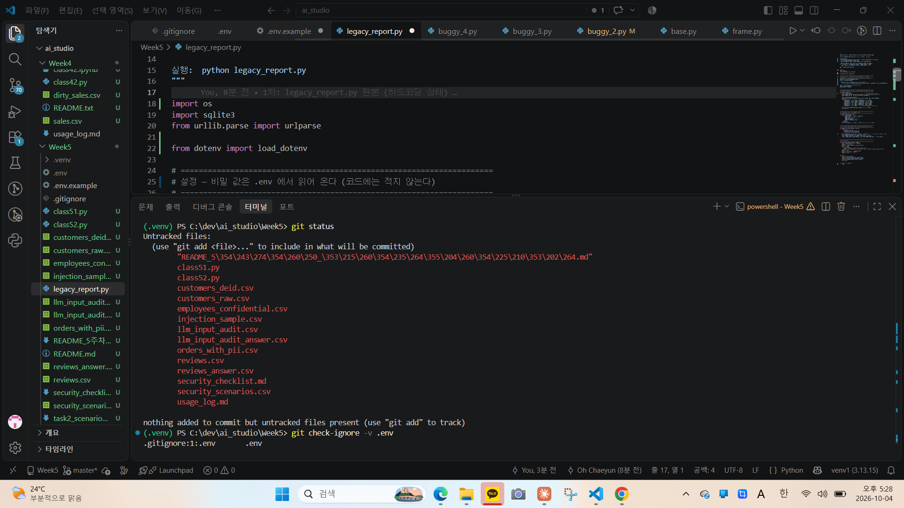
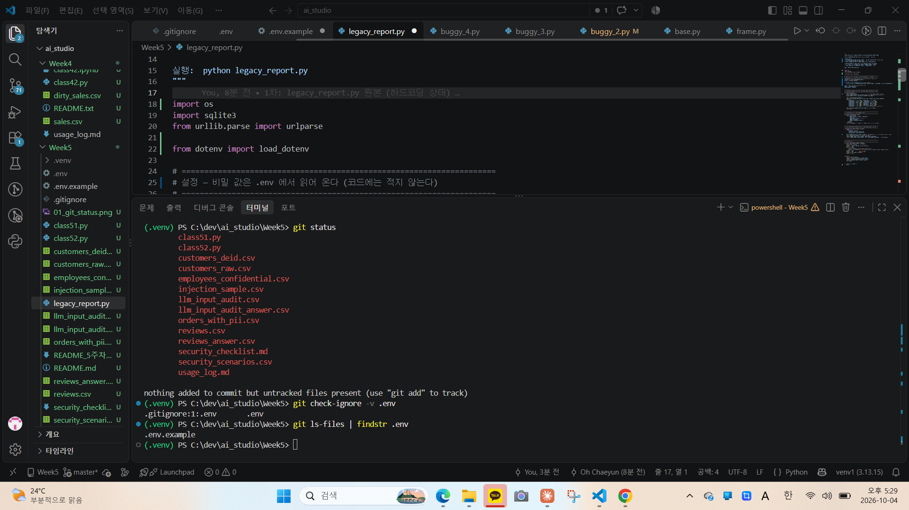
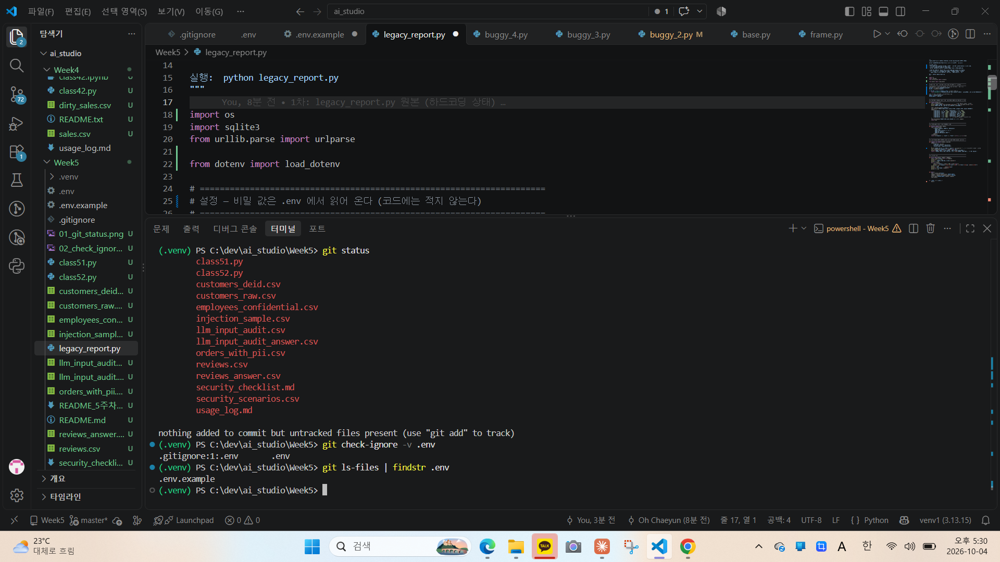

# AI 오케스트레이션 스튜디오 — 5주차 과제

| 과제 | 파일 |
|---|---|
| 과제 1 — 하드코딩 키 리팩터링 | `legacy_report.py`, `.env.example`, `.gitignore`, 이 README, `captures/` |
| 과제 2 — 보안 위반 시나리오 대응 메모 | `task2_scenarioA_memo.md` |
| 과제 3 — 캡스톤 개인 아이디어 노트 | `task3_idea_note.md` (LMS 병행 제출) |
| 공통 | `security_checklist.md`, `usage_log.md` |

---

## 과제 1 — 하드코딩 키 리팩터링

### ① 무엇이 위험했는가
원본 `legacy_report.py`에는 위험 요소가 네 군데 있었다.
- API 키(`API_KEY`)가 소스코드에 문자열로 하드코딩되어 있었다.
- DB 접속 문자열(`DB_URL`)에 계정·비밀번호·내부 IP가 그대로 들어 있었다.
- "혹시 몰라서 남겨둔" 예전 키가 주석으로 남아 있었다. 주석도 코드와 똑같이 커밋·공개된다.
- `[DEBUG]` 로그가 DB 비밀번호가 포함된 접속 문자열과 API 키가 담긴 요청 헤더를 그대로 출력했다.

이 상태로 퍼블릭 저장소에 push하면 키 패턴을 훑는 자동화 봇이 수 분 안에 수집해 과금 폭탄·서비스 중단·DB 침입으로 이어질 수 있다.
또한 Git은 이력을 보존하므로, 나중에 해당 줄을 지워도 과거 커밋에서 누구나 키를 볼 수 있다.

### ② 어떻게 고쳤는가
비밀 값은 코드 밖 `.env` 파일로 옮기고, 코드는 `python-dotenv`의 `load_dotenv()`와 `os.getenv()`로 실행 시점에 읽어 오도록 바꿨다.
`.env`는 `.gitignore`에 등록해 Git이 추적하지 않게 했고, 팀원이 채워야 할 항목은 빈 값으로 된 `.env.example`로 공유한다.
키가 없으면 `RuntimeError`를 발생시키고, 주석의 예전 키는 삭제했다.
DEBUG 로그는 접속 문자열 출력을 없애고(호스트·DB 이름만 출력), API 키는 앞 8자리만 보이도록 바꿨다.

### ③ 실키가 1차 커밋으로 노출되었다면 (3.3절 5단계)
1. 파일에서 지우는 것이 아니라 **즉시 해당 키를 폐기(revoke)하고 재발급**받는다 — 유일한 확실한 무효화 방법이다.
2. 새 키는 `.env`로 격리하고 `.gitignore`를 정비한다.
3. 사용량·청구 내역을 점검하고 이상 사용이 있으면 사업자에 신고한다.
4. 히스토리에 남은 옛 키는 이미 무효이므로 위협이 아니며, 저장소 정리가 필요하면 이력 재작성 도구를 쓴다.

> 이번 1차 커밋의 키는 과제용 **더미 키**이므로 실제 위험은 없다.

### 검증 캡처 (.env 미추적 증명)
| 명령 | 캡처 |
|---|---|
| `git status` — 목록에 `.env`가 보이지 않음 |  |
| `git check-ignore -v .env` — `.gitignore:1:.env .env` 출력 |  |
| `git ls-files \| findstr .env` — `.env.example`만 출력, `.env`는 없음 |  |
